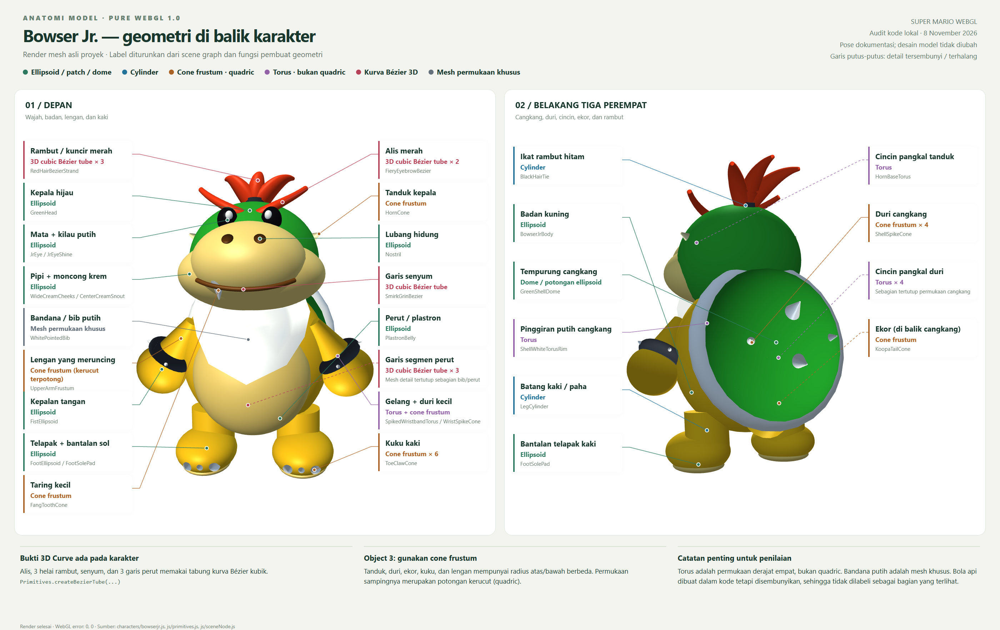
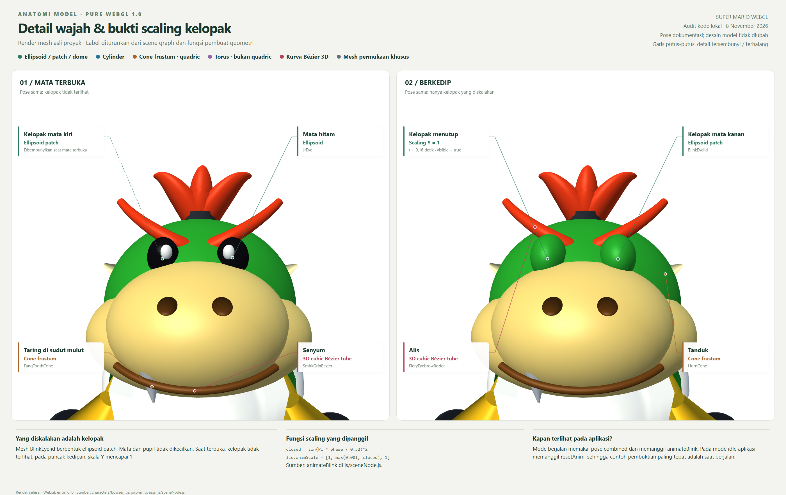

# Audit kriteria Bowser Jr.

Tanggal: 8 November 2026. Sumber: kode lokal yang sedang dibuka, bukan komentar deskriptif versi lama.

> Catatan versi: audit dan gambar anatomi pada dokumen ini merekam model sebelum perapian posisi dan penyesuaian tujuh duri sesuai referensi. Lihat [hasil model terbaru](posisi-sesudah.png) serta [catatan perbaikan](perbaikan-posisi.md). Jumlah node dan nomor baris di bawah adalah snapshot versi audit tersebut.

**Kesimpulan:** kriteria geometri dan transformasi tersedia pada implementasi Bowser Jr. Aspek aesthetic memiliki dasar visual, tetapi perpindahan mode berjalan ke idle belum menggunakan transisi halus. Penilaian aesthetic tetap bersifat kualitatif; dokumen ini tidak menjamin skor dosen.





Kedua gambar diambil dari render WebGL mesh `createBowserJr` asli. Kamera, pose diam, latar putih, dan pencahayaan studio diatur hanya untuk dokumentasi. Geometri, warna material, dan kode aplikasi tidak diubah. Titik label diproyeksikan dari transformasi scene graph. Untuk detail yang terhalang, label mengacu pada posisi mesh dalam model, bukan klaim bahwa seluruh permukaannya terlihat.

## Pemetaan terhadap rubrik

| Kriteria | Status | Bukti implementasi |
| --- | --- | --- |
| 3D Curve harus di karakter | Terpenuhi | 2 alis, 3 helai rambut, 1 senyum, dan 3 garis perut memakai `createBezierTube`. Gunakan alis/rambut/senyum sebagai bukti visual utama karena sebagian garis perut tertutup bib atau perut. |
| Object 1 bebas | Terpenuhi | Badan kuning memakai ellipsoid, radius X/Y/Z = 0.58/0.60/0.50. |
| Object 2 bebas | Terpenuhi | Batang kaki memakai cylinder, radius 0.17, tinggi 0.30; ikat rambut juga cylinder. |
| Object 3 quadric selain ellipsoid/cylinder | Terpenuhi melalui cone frustum | Tanduk memakai radius bawah 0.085, atas 0.008, tinggi 0.20. Duri cangkang, ekor, kuku, dan lengan juga cone frustum. |
| Aesthetic: environment + smooth transform | Ada dasar; ada catatan | Model memakai normal permukaan, lighting, depth testing, dan environment 3D. Ayunan sendi/lintasan memakai sinus/cosinus. Perpindahan antarmode masih langsung memindahkan posisi dan tinggi. FPS perangkat nyata belum diukur. |
| Translate | Terpenuhi | Root Bowser Jr. bergerak pada lintasan melingkar di `applyWalkMovement`, dipanggil untuk ketiga karakter pada mode berjalan. |
| Rotate | Terpenuhi | `rotation[1] = -angle` mengatur arah root; bahu, pinggul, kepala, rambut, dan ekor memiliki rotasi animasi lokal. |
| Scaling | Terpenuhi pada bagian karakter | Dua node `BlinkEyelid` mengalami scaling Y pada `animateBlink`. Ini bukan animasi membesarkan/mengecilkan seluruh badan. |
| Rotate Arbitrary Axis | Terpenuhi | Root memakai sumbu `[1, 0, 1]`, sudut `0.09 * sin(4.5t)`, lalu diproses oleh `Mat4.rotateAxis` (rumus Rodrigues). |
| Hierarchical Transformation | Terpenuhi | `SceneNode.draw` meneruskan matriks lokal induk ke anak; kepala, lengan, kaki, dan cangkang mengikuti badan serta root. |

## Jenis objek pada bagian tubuh

| Bagian | Node pada kode | Jenis geometri aktual |
| --- | --- | --- |
| Badan kuning | BowserJrBody | Ellipsoid |
| Perut/plastron | PlastronBelly | Ellipsoid |
| Tiga garis perut | BellyRibBezier | Tabung kurva Bézier kubik 3D |
| Bandana putih | WhitePointedBib | Mesh khusus: polygon outline yang disubdivisi mengikuti permukaan dada |
| Tempurung hijau punggung | GreenShellDome | Dome / bagian permukaan ellipsoid, dengan penutup dasar |
| Pinggiran cangkang putih | ShellWhiteTorusRim | Torus |
| Empat duri cangkang | ShellSpikeCone | Cone frustum |
| Empat cincin pangkal duri | SpikeBaseRing | Torus |
| Ekor | KoopaTailCone | Cone frustum; sebagian tertutup cangkang pada sudut dokumentasi |
| Kepala hijau | GreenHead | Ellipsoid |
| Pipi krem | WideCreamCheeks | Ellipsoid |
| Moncong tengah | CenterCreamSnout | Ellipsoid |
| Dua lubang hidung | Nostril | Ellipsoid |
| Satu taring | FangToothCone | Cone frustum |
| Garis senyum | SmirkGrinBezier | Tabung kurva Bézier kubik 3D |
| Dua mata hitam | JrEye | Ellipsoid |
| Dua kilau mata | JrEyeShine | Ellipsoid |
| Dua kelopak | BlinkEyelid | Ellipsoid patch; visible hanya pada fase berkedip |
| Dua alis merah | FieryEyebrowBezier | Tabung kurva Bézier kubik 3D |
| Dua tanduk | HornCone | Cone frustum |
| Dua pangkal tanduk | HornBaseTorus | Torus |
| Ikat rambut hitam | BlackHairTie | Cylinder |
| Tiga helai rambut | RedHairBezierStrand | Tabung kurva Bézier kubik 3D |
| Dua lengan | UpperArmFrustum | Cone frustum, radius bawah 0.13 dan atas 0.049 |
| Dua gelang besi | SpikedWristbandTorus | Torus |
| Delapan duri gelang | WristSpikeCone | Cone frustum |
| Dua kepalan tangan | FistEllipsoid | Ellipsoid |
| Dua batang kaki | LegCylinder | Cylinder |
| Dua telapak kaki | FootEllipsoid | Ellipsoid |
| Dua bantalan sol | FootSolePad | Ellipsoid |
| Enam kuku kaki | ToeClawCone | Cone frustum |
| Inti bola api | FireCore | Ellipsoid, tersembunyi karena FireballProjectile.visible = false |
| Ekor bola api | FireTailCone | Cone frustum, tersembunyi bersama projectile |

## Koreksi istilah yang penting

- **Torus bukan quadric.** Persamaan torus standar berderajat empat. Jangan menggunakannya sebagai bukti Object 3 walaupun komentar lama menyebutnya quadric.
- **Cone frustum memenuhi keluarga permukaan quadric melalui sisi kerucutnya.** Untuk sumbu Y, sisi tersebut dapat ditulis `x² + z² - (a + b*y)² = 0`, dengan batas interval Y. Ini persamaan derajat dua. Pada model ini radius ujung tidak tepat nol, sehingga istilah yang paling presisi adalah kerucut terpotong, bukan kerucut dengan puncak sempurna.
- **Lengan bukan cylinder.** Radius atas dan bawah berbeda. Cylinder yang jelas untuk Object 2 berada pada batang kaki dan ikat rambut.
- **Bandana saat ini bukan cone dan tidak memakai motif mulut Bézier.** `WhitePointedBib` adalah mesh permukaan putih khusus; komentar pengantar file masih menyebut motif versi sebelumnya.
- **Efek bola api dinonaktifkan.** `FireCore` dan `FireTailCone` dibuat tetapi tidak terlihat saat animasi biasa; jangan menjadikannya bukti visual utama.

## Bukti transformasi yang dapat dijelaskan saat presentasi

### Translasi dan rotasi arah

Bowser Jr. memiliki followerIndex = 1 dalam urutan Toad → Bowser Jr. → Yoshi. Rumus lintasannya:

```js
angle = 0.45 * t - 2 * Math.PI / 3;
x = 2 * Math.cos(angle);
z = environmentNode.walkCenterZ + 2 * Math.sin(angle);
rotationY = -angle;
```

Pusat Z saat audit adalah 6.3. Satu putaran membutuhkan sekitar 13.96 detik. Posisi Y dikoreksi dari geometri telapak agar menapak. Perubahan posisi X/Z adalah translasi; rotasi Y mengubah arah hadap.

### Scaling dan arbitrary axis

```js
// Kelopak: satu siklus kedipan setiap 3 detik, durasi kedipan 0.32 detik.
phase = t % 3;
closed = phase < 0.32 ? Math.sin(Math.PI * phase / 0.32) ** 2 : 0;
lid.animScale = [1, Math.max(0.001, closed), 1];

// Root: goyangan kecil pada sumbu diagonal, bukan sumbu X/Y/Z tunggal.
character.animAxis = [1, 0, 1];
character.animAxisAngle = Math.sin(t * 4.5) * 0.09;
```

Pada t = 0.16, skala Y kelopak = 1 dan kelopak terlihat. Pada t = 1, skala Y = 0.001 dan kelopak disembunyikan. `SceneNode.draw` mengalikan skala dasar dengan animScale sebelum menggambar mesh. Scaling paling tepat didemonstrasikan saat mode berjalan karena mode idle aplikasi memanggil resetAnim dan menghilangkan animasi kedipan.

Sudut arbitrary axis maksimum 0.09 radian, sekitar 5.16 derajat. Sumbu dinormalisasi di `Mat4.rotateAxis`, lalu rotasinya dikomposisikan dengan transformasi node. Ini benar-benar dipanggil untuk Bowser Jr. pada mode berjalan, bukan hanya fungsi utilitas yang tidak terpakai.

### Contoh hierarki

```text
BowserJrRoot
└─ BowserJrBody
   ├─ BowserJrHeadPivot → GreenHead
   │  ├─ CenterCreamSnout → SmirkGrinBezier / FangToothCone
   │  ├─ JrEye → JrEyeShine / BlinkEyelid
   │  ├─ HornGroup → HornBaseTorus / HornCone
   │  └─ PonytailGroup → BlackHairTie / RedHairBezierStrand
   ├─ LeftShoulder → UpperArmFrustum → Wrist
   │  └─ SpikedWristbandTorus / WristSpikeCone / FistEllipsoid
   ├─ LeftHip → LegCylinder → FootEllipsoid
   │  └─ FootSolePad / ToeClawCone
   ├─ SpikedShellGroup → GreenShellDome / ShellWhiteTorusRim
   │  └─ ShellSpikePivot → SpikeBaseRing / ShellSpikeCone
   └─ TailPivot → KoopaTailCone
```

Cabang kanan lengan/kaki memakai struktur yang sama. Node pivot tidak harus mempunyai mesh: fungsinya mengatur pusat dan pewarisan transformasi.

## Catatan aesthetic dan smoothness

Dalam mode berjalan, rotasi sendi serta posisi lintasan memakai fungsi kontinu. Akan tetapi `setAnimMode` memanggil `setViewMode` yang mereset kamera, dan renderLoop mengubah standingY dari groundY (-2.375) menjadi surfaceY (0) saat kembali ke idle. Posisi X/Z juga langsung dikembalikan ke formasi berdampingan. Jadi perpindahan mode masih dapat terlihat meloncat; belum ada interpolasi posisi/rotasi kamera atau blend pose lintas mode.

Shadow mapping dan contact shadow saat audit dinonaktifkan secara eksplisit di renderWorld. Lighting ambient/directional, highlight, fog, normal permukaan dan depth testing tetap ada. Ini tidak menghapus pemenuhan transformasi/geometri, tetapi tidak boleh dipresentasikan sebagai bukti bayangan matahari dinamis yang sedang aktif.

## Metode pemeriksaan

- Audit scene graph dengan menjalankan fungsi pembuatan Bowser Jr. dan geometri asli pada Node.js, sambil mencatat asal tiap mesh.
- Sampling pose combined pada t = 0.16, 1, 2, dan 3.16: posisi, arah hadap, arbitrary-axis rotation, serta skala kelopak tercatat di inventory.json.
- Render dua sudut dan pembesaran wajah menggunakan Chrome headless, WebGL 1.0/SwiftShader. Kedua canvas pada tiap lembar menghasilkan WebGL error = 0.
- Shader dokumentasi berhasil dikompilasi dan di-link. Ini validasi renderer dokumentasi, bukan klaim benchmark FPS pada GPU perangkat nyata.
- Kode aplikasi tidak diubah. File baru hanya berada di docs/bowserjr.

## Sumber kode

- `characters/bowserjr.js:26` — const bodyMesh
- `characters/bowserjr.js:39` — const ribCurve
- `characters/bowserjr.js:62` — function bibPaint
- `characters/bowserjr.js:93` — const shellDomeMesh
- `characters/bowserjr.js:104` — const spikeConeMesh
- `characters/bowserjr.js:198` — const browCurveMesh
- `characters/bowserjr.js:212` — const hornConeMesh
- `characters/bowserjr.js:260` — const upperArmMesh
- `characters/bowserjr.js:300` — const legCylMesh
- `characters/bowserjr.js:335` — root.animate =
- `js/main.js:400` — function applyWalkMovement
- `js/main.js:427` — const poseMode
- `js/main.js:437` — const standingY
- `js/sceneNode.js:75` — localMatrix = Mat4.rotateAxis
- `js/sceneNode.js:142` — function animateBlink
- `js/math3d.js:78` — rotateAxis: function
- `js/primitives.js:369` — createBezierTube: function

## Inventaris hasil eksekusi

Ditemukan 68 node bermesh, termasuk 2 kelopak dan 2 bagian projectile tersembunyi. Ada 9 node kurva Bézier. Jumlah node bukan jumlah buffer geometri unik; beberapa node berbagi mesh.

| Nama node | Pembuat geometri | Jumlah |
| --- | --- | --- |
| BowserJrBody | createEllipsoid | 1 |
| PlastronBelly | createEllipsoid | 1 |
| BellyRibBezier | createBezierTube | 3 |
| WhitePointedBib | custom mesh | 1 |
| GreenShellDome | createDome | 1 |
| ShellWhiteTorusRim | createTorus | 1 |
| SpikeBaseRing | createTorus | 4 |
| ShellSpikeCone | createConeFrustum | 4 |
| KoopaTailCone | createConeFrustum | 1 |
| GreenHead | createEllipsoid | 1 |
| WideCreamCheeks | createEllipsoid | 1 |
| CenterCreamSnout | createEllipsoid | 1 |
| Nostril | createEllipsoid | 2 |
| FangToothCone | createConeFrustum | 1 |
| SmirkGrinBezier | createBezierTube | 1 |
| JrEye | createEllipsoid | 2 |
| JrEyeShine | createEllipsoid | 2 |
| BlinkEyelid | createEllipsoidPatch | 2 |
| FieryEyebrowBezier | createBezierTube | 2 |
| HornBaseTorus | createTorus | 2 |
| HornCone | createConeFrustum | 2 |
| BlackHairTie | createCylinder | 1 |
| RedHairBezierStrand | createBezierTube | 3 |
| FireCore | createEllipsoid | 1 |
| FireTailCone | createConeFrustum | 1 |
| UpperArmFrustum | createConeFrustum | 2 |
| SpikedWristbandTorus | createTorus | 2 |
| WristSpikeCone | createConeFrustum | 8 |
| FistEllipsoid | createEllipsoid | 2 |
| LegCylinder | createCylinder | 2 |
| FootEllipsoid | createEllipsoid | 2 |
| FootSolePad | createEllipsoid | 2 |
| ToeClawCone | createConeFrustum | 6 |

## Reproduksi dan identitas sumber

Jalankan dari root repositori: `node docs/bowserjr/audit.cjs`. Buka `docs/bowserjr/anatomi.html` dan `detail.html` melalui browser untuk melihat lembar gambar.

- `characters/bowserjr.js` — SHA256 `dc965242f37611ccc89d510380bc005a1955cd63bfa055fe9a9e358a91fd5e14`
- `js/primitives.js` — SHA256 `9c335ba383a1b045bcb40395f7aa5d50f4a9f343bf7823cb2335bfa1477c09a5`
- `js/sceneNode.js` — SHA256 `d19e3479066aa92e3860822c3bbd0463210368d4915c2e63b3edb41816d41ed5`
- `js/main.js` — SHA256 `c3c1466810c276e132ced8d39efa6a5a982de2723296018c0e12a286c2b2666e`
- `js/math3d.js` — SHA256 `f419c1503b43c331593691d42259df1fd7e4b109efa0454005b6e9a2902d4b5c`
