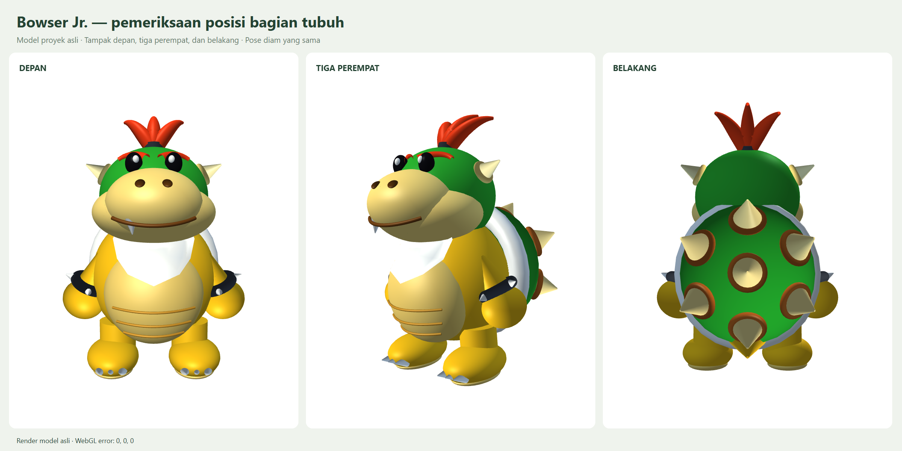
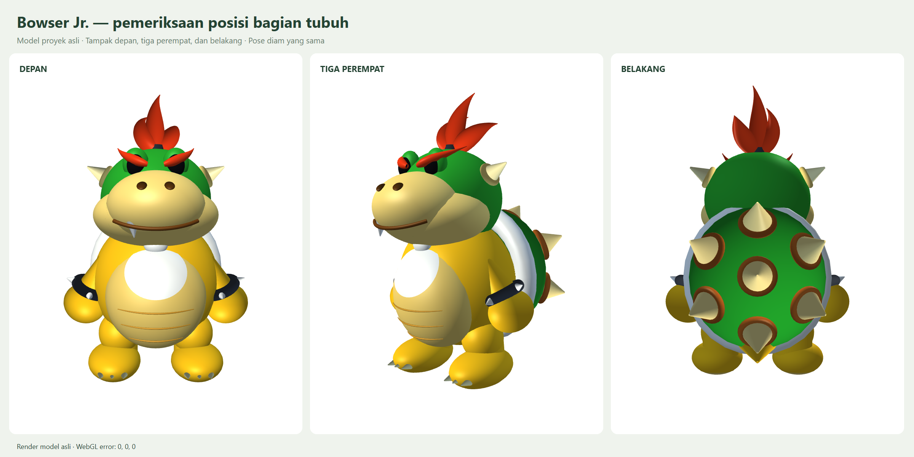
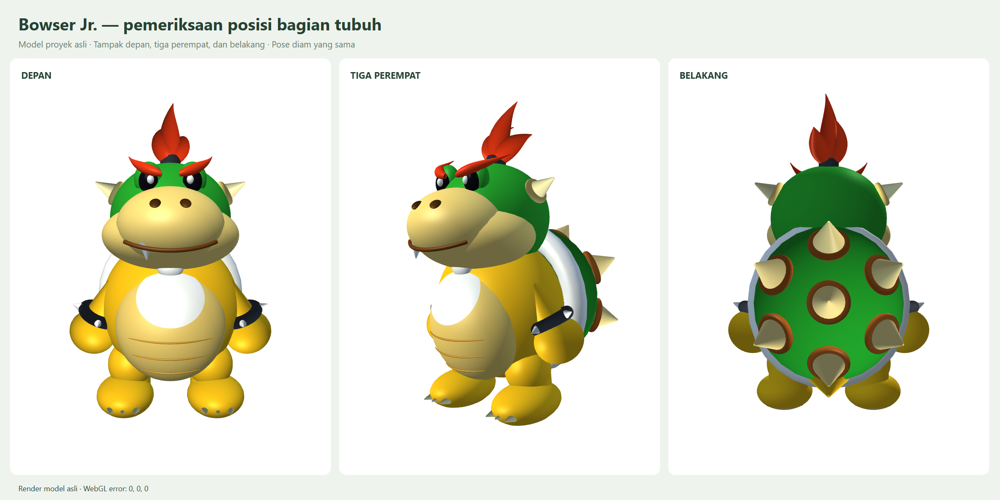

# Perapian Bowser Jr. dan duri sesuai referensi

- Tujuh cone frustum krem disusun: satu di atas, dua di sisi atas, satu di tengah, dua di sisi bawah, satu di bawah.
- Cincin pangkal memakai torus cokelat-oranye. Titik pangkal dihitung dari persamaan ellipsoid cangkang; arah duri mengikuti normal permukaannya.
- Bib lebih rapi di bagian dada, tiga garis perut mengikuti permukaan perut, alis berada di atas mata, pangkal tanduk lebih jelas, serta lengan, gelang, cincin cangkang, dan ekor diselaraskan.
- Jenis geometri, sembilan kurva Bezier, struktur hierarki, dan fungsi animasi dipertahankan. Warna krem/cokelat baru hanya diterapkan pada duri cangkang dan cincin pangkal sesuai referensi.
- Kode model situs dan snapshot trailer menggunakan file Bowser Jr. yang sama.

## Validasi

`node docs/bowserjr/validate-positions.cjs` menguji 564 pose (idle/walk/action/combined), mempertahankan sembilan kurva Bezier, memeriksa arah dan pangkal ketujuh duri, jarak garis perut terhadap permukaan, serta nilai transformasi dan koreksi kaki yang finite. Hasil: lolos; 74 node bermesh, posisi kaki terkoreksi tanpa error.

Render Chrome headless dari depan, tiga perempat, dan belakang menghasilkan WebGL error 0 pada ketiga canvas. Renderer aplikasi juga telah diperiksa pada mode env dan bowserjr untuk idle/walk/action selama perapian posisi: shader link berhasil, tidak ada error runtime/WebGL, dan kaki menapak. Setelah perubahan susunan duri, render tiga arah serta 564 pose diperiksa kembali.

Foto sebelum perbaikan: [posisi-sebelum.png](posisi-sebelum.png).

Tidak ada commit atau push.

## Kelopak mata, bandana, garis perut, dan kaki (pembaruan)

- Dua EyeLidBaseEllipsoid hijau berada di belakang mata hitam. Alis ditempatkan kembali di atas permukaan kelopak tersebut. Animasi BlinkEyelid tetap terpisah dan berfungsi.
- Polygon napkin diganti dengan WhiteBandanaPatch (ellipsoid patch), WhiteBandanaCollar (torus), dan BandanaKnotEllipsoid. Patch mengikuti pusat/kurvatur perut sehingga tepinya menempel di dada.
- Tiga garis perut masih merupakan kurva Bezier 3D, sekarang lebih tipis, memiliki ujung meruncing, dan mengikuti lengkungan perut tanpa tenggelam.
- Dua ThighJointEllipsoid menutupi sambungan atas cylinder kaki. Cylinder tetap digunakan sebagai inti batang kaki untuk kriteria objek.
- FootSolePad sekarang merupakan ellipsoid patch yang mengikuti bagian bawah telapak, bukan ellipsoid terpisah berbentuk kepingan. Kuku dirapikan posisi, arah, serta warnanya.
- Snapshot model trailer telah disamakan dengan model situs.

Validasi pembaruan: 80 node bermesh, sembilan kurva Bezier, 564 pose lolos; dua kelopak dasar dan dua sambungan paha terverifikasi. Posisi dan normal duri tetap sesuai permukaan cangkang. Patch sol berada tepat di luar permukaan ellipsoid telapak. Chrome headless berhasil merender tiga sudut pada pose diam dan animasi (termasuk berkedip), dengan WebGL error 0. Renderer aplikasi diuji pada mode env dan bowserjr untuk idle/walk/action; tidak ada error runtime/WebGL dan kaki menapak.

[Pose berjalan dan berkedip](kelopak-bandana-animasi.png).

## Alis turun dan rambut sesuai referensi terbaru

Bagian dalam alis diturunkan mendekati pangkal hidung, sedangkan ujung luar dibuat melengkung ke atas. Tiga helai rambut yang sama ditata lebih rapat, bertingkat, tebal di bagian pangkal, dan meruncing ke belakang. Pembentukan rambut dilakukan dalam orientasi lokal horizontal lalu dikembalikan lewat rotasi node untuk menghindari pergantian frame tabung saat kurva mendekati arah vertikal.

Tidak ada penambahan jenis objek atau node mesh: tetap 80 node bermesh, terdiri dari 21 ellipsoid, 5 ellipsoid patch, 13 torus, 1 dome, 28 cone frustum, 3 cylinder, dan 9 tabung kurva Bezier. Alis tetap dua kurva Bezier; rambut tetap tiga kurva Bezier. Kode model situs dan trailer sama. Uji 564 pose lolos, dan render tiga arah menghasilkan WebGL error 0.

## Alis sedikit lebih tinggi, mata putih terlihat, dan ikatan rambut terbuka

Alis dinaikkan 0.045 unit tanpa menghilangkan kemiringan galaknya. Kilau putih mata diposisikan sedikit lebih rendah dan ke depan agar terlihat di bawah alis saat mata terbuka. Ketiga pangkal jambul dirapatkan dan ditempatkan tepat di atas cylinder ikatan rambut; bentangan helai samping diperkecil agar bagian hitam ikatan terlihat.

Tidak ada jenis objek atau node tambahan. Model situs dan trailer disamakan. Uji 564 pose lolos dan render depan, tiga perempat, serta belakang menghasilkan WebGL error 0.
